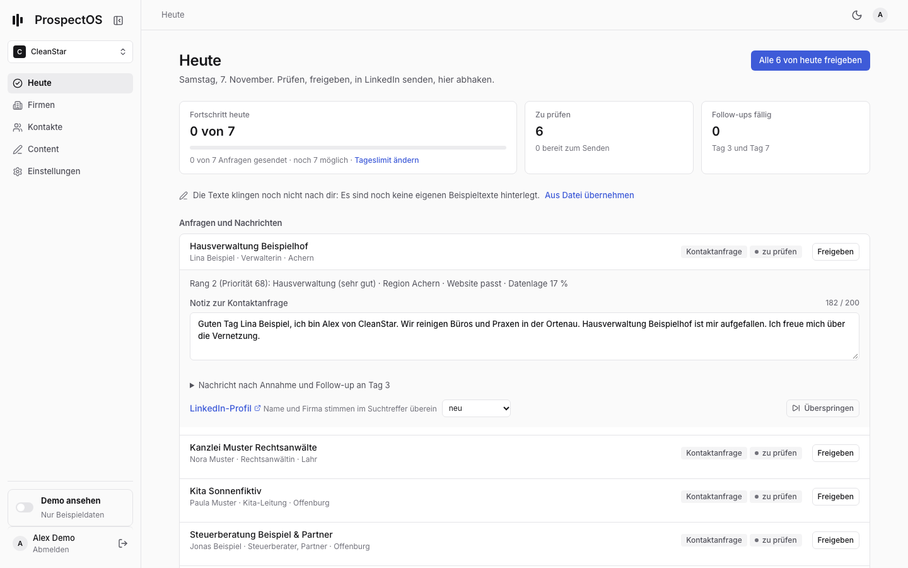
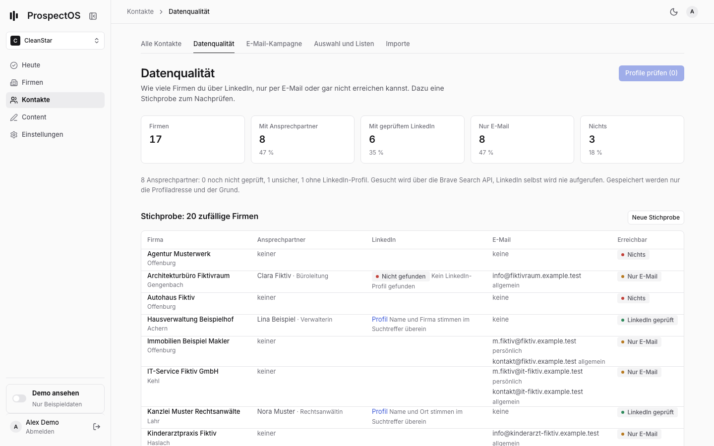
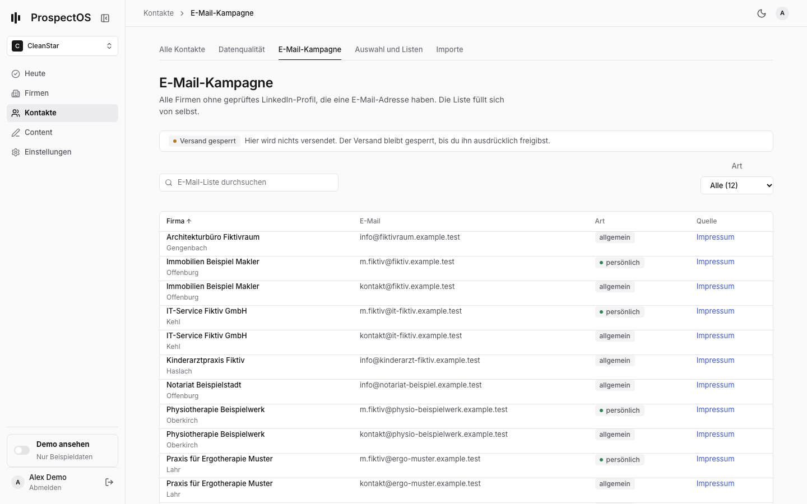
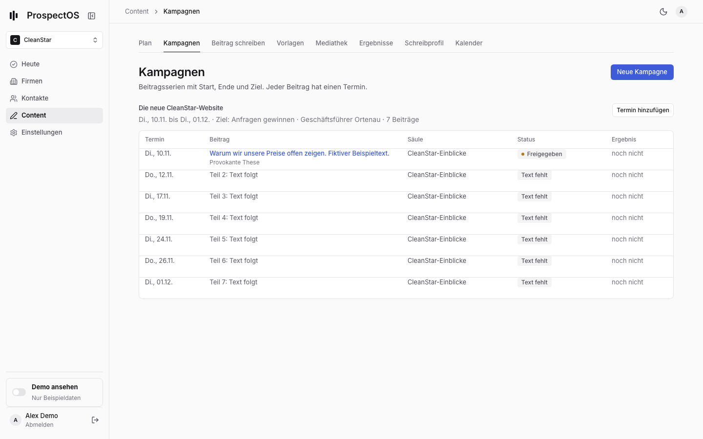
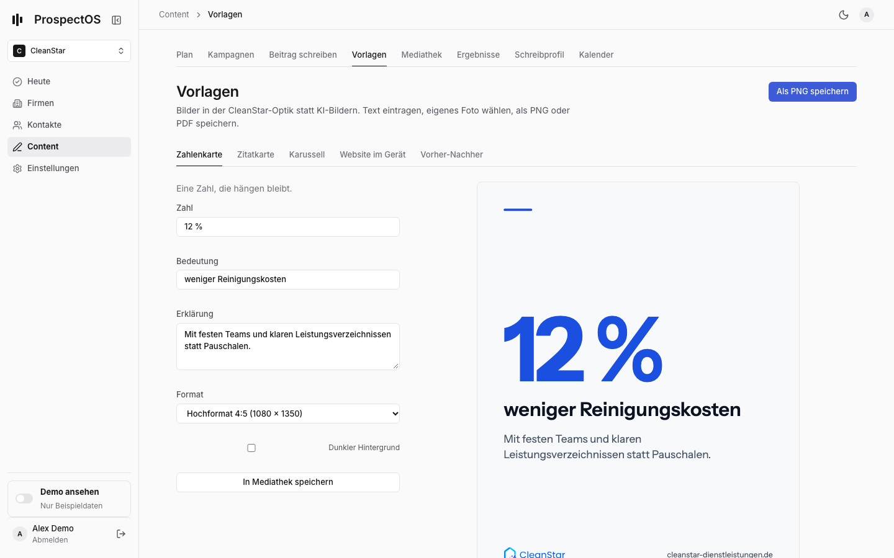
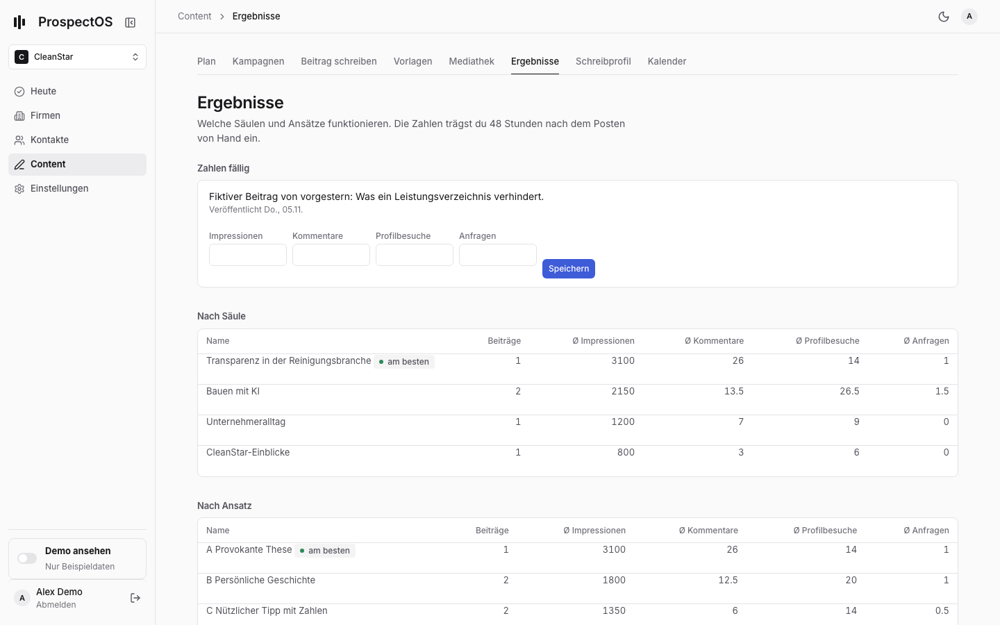
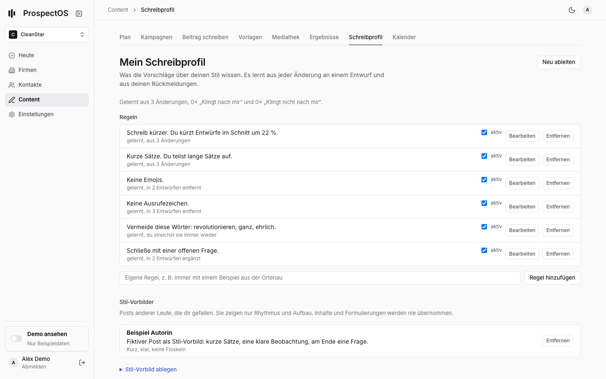
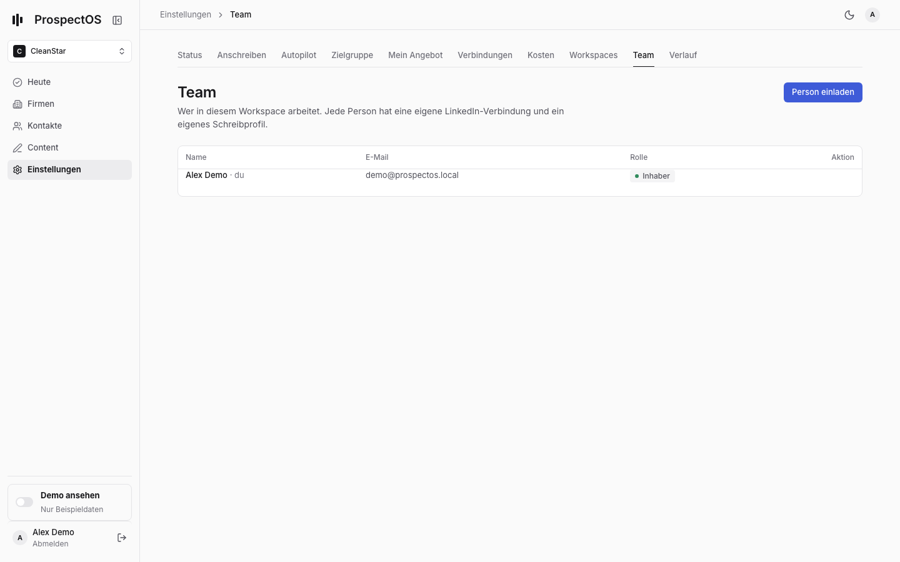
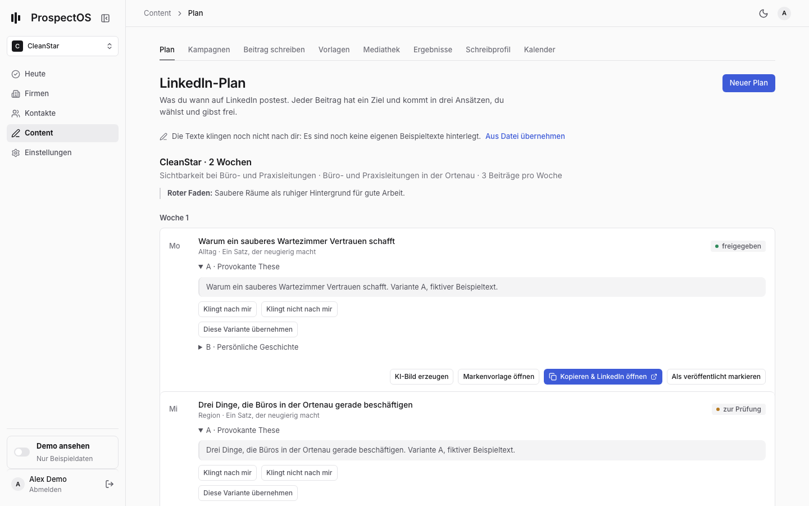
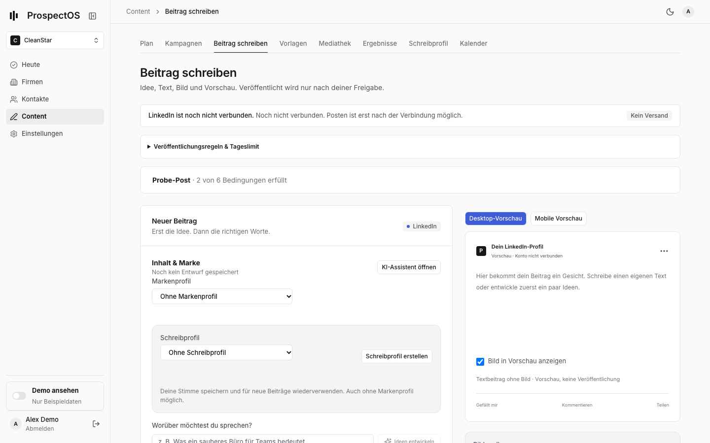

# Neue Seiten: Profile, Content-Strategie, Schreibprofil, Team (07.11.2026)

Alle Bilder stammen aus dem isolierten Teststack mit erfundenen Daten („Fiktiv“, „Beispiel“,
`example.test`). Desktop 1440 px, Handy 390 px, dazu Dunkelmodus (`*-desktop-dark.png`).

Neu erzeugen:
`infra/scripts/design-shots.sh neue-seiten "heute=/today,datenqualitaet=/contacts/quality,…"`

| Seite | Wo | Bild |
|---|---|---|
| Heute | Startseite |  |
| Datenqualität | Kontakte → Datenqualität |  |
| E-Mail-Kampagne | Kontakte → E-Mail-Kampagne |  |
| Kampagnen | Content → Kampagnen |  |
| Vorlagen | Content → Vorlagen |  |
| Ergebnisse | Content → Ergebnisse |  |
| Schreibprofil | Content → Schreibprofil |  |
| Team | Einstellungen → Team |  |
| Plan | Content → Plan |  |
| Beitrag schreiben | Content → Beitrag schreiben |  |

Handy: [Heute](heute-mobile.png), [Datenqualität](datenqualitaet-mobile.png),
[E-Mail-Kampagne](email-kampagne-mobile.png), [Kampagnen](kampagnen-mobile.png),
[Vorlagen](vorlagen-mobile.png), [Ergebnisse](ergebnisse-mobile.png),
[Schreibprofil](schreibprofil-mobile.png), [Team](team-mobile.png).

## Was jede Seite tut

- **Heute:** Hier stehen nur Kontakte mit geprüftem LinkedIn-Profil. Der Knopf kopiert die Notiz und öffnet genau dieses Profil. Neben dem Profil steht der Grund (z. B. „Name und Firma stimmen im Suchtreffer überein“). Fehlen Prüfungen, steht oben ein Hinweis mit „Jetzt prüfen“. 48 Stunden nach einem Beitrag fragt die Seite nach dessen Zahlen.
- **Datenqualität:** Zeigt, wie viele Firmen es gibt, wie viele davon mit Ansprechpartner, mit geprüftem LinkedIn, nur mit E-Mail oder ohne beides. Dazu eine Stichprobe von 20 zufälligen Firmen zum Nachprüfen und der Knopf „Profile prüfen“.
- **E-Mail-Kampagne:** Alle Firmen ohne geprüftes Profil, die eine E-Mail-Adresse haben. Jede Adresse ist als persönlich oder allgemein markiert und mit Quelle versehen. Der Versand ist gesperrt, es gibt keinen Sende-Knopf.
- **Kampagnen:** Serien mit Start, Ende, Ziel und Zielgruppe. Jeder Beitrag hat einen Termin. Texte kannst du direkt einfügen. Zahlen trägst du nach der Veröffentlichung ein.
- **Vorlagen:** Zahlenkarte, Zitatkarte, Karussell (als PDF), Website im Gerät und Vorher-Nachher, alle in CleanStar-Schrift, -Farben und mit Logo. Speichern geht als PNG oder direkt in die Mediathek. Eigene Fotos lädst du hoch und verwendest sie in den Vorlagen.
- **Ergebnisse:** Durchschnittswerte pro Säule, Ansatz und Ziel, dazu die Beiträge, deren Zahlen fällig sind. Der Hinweis „funktioniert am besten“ fließt in neue Vorschläge ein.
- **Schreibprofil:** Regeln in normaler Sprache, abgeleitet aus deinen Änderungen und Rückmeldungen. Du kannst sie bearbeiten, abschalten, entfernen oder eigene hinzufügen. Dazu Stil-Vorbilder (fremde Posts, nur als Vorbild für Rhythmus) und deine letzten Änderungen.
- **Team:** Personen als Inhaber oder Mitglied einladen. Weil es noch kein System-Mailing gibt, bekommst du einen Einladungslink zum Kopieren.

## Selbstkritik

- **Vorlagen:**
  - Die Vorschau ist ein Bild der späteren Datei. Text änderst du links, nicht direkt im Bild.
  - Website-Screenshots lädst du selbst hoch, ProspectOS macht sie nicht.
- **Beitrag schreiben:** Die Auswahl von Ziel, Zielgruppe und Säule steckt im aufklappbaren KI-Assistenten. Der Editor selbst ist noch im alten Aufbau.
- **Tabs:** Im Bereich Content stehen jetzt acht Tabs. Auf dem Handy scrollen sie seitlich.
